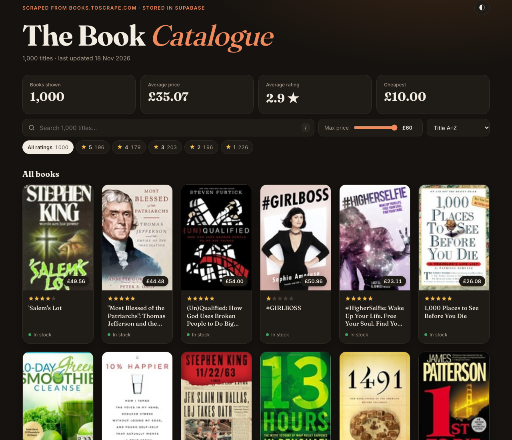

# Books to Scrape → Supabase → Book Catalogue

A Python pipeline that scrapes all 1,000 books from [books.toscrape.com](https://books.toscrape.com), stores them in a [Supabase](https://supabase.com) (PostgreSQL) database, and presents them in a searchable web page.



**Contents:**
[Purpose](#purpose) · [Data collection](#data-collection) · [Data persistence](#data-persistence) · [User interaction](#user-interaction) · [Setup](#setup) · [Learning](#learning) · [Limitations and assistance](#limitations-and-assistance) · [Audit](AUDIT.md)

## Purpose

This project is the *Books to Scrape* assignment: collect book data, store it in a database and present it through an interface. It does three things:

1. **Scrape:** `scraper.py` reads every page of the online bookshop and extracts the title, price, star rating, availability, product link and cover image of each book.
2. **Store:** `main.py` writes the books into a `books` table in Supabase. Running it again updates the rows instead of creating duplicates.
3. **Present:** `build_page.py` reads the books back from Supabase and generates `index.html`, a self-contained catalogue page with search, filters, sorting and statistics.

```
books.toscrape.com ──scraper.py──▶ Python dicts ──db.py──▶ Supabase "books" table ──build_page.py──▶ index.html
                                   (main.py runs the whole chain)
```

### Project structure

| File | Purpose |
|---|---|
| `scraper.py` | Downloads and parses all 50 catalogue pages (`requests` + `BeautifulSoup`) |
| `db.py` | Supabase client and helpers: count, upsert, read all rows |
| `main.py` | Runs the whole pipeline: scrape → save → rebuild page |
| `build_page.py` | Reads all books from Supabase and writes `index.html` |
| `templates/page.html` | HTML/CSS/JavaScript design of the catalogue page |
| `index.html` | Generated catalogue page (committed so it can be viewed without any setup) |
| `schema.sql` | SQL that creates the `books` table |
| `setup_supabase.py` | Asks for the Supabase URL and key, writes `.env`, tests the connection |
| `test_connection.py` | Checks that the credentials work and that the table exists |
| `.env.example` | Template for the configuration (placeholders only) |
| `requirements.txt` | Pinned Python dependencies |
| `AUDIT.md` | Publication audit: what was checked, found and fixed |
| `docs/screenshot.png` | Screenshot used in this README |

## Data collection

**Source:** [books.toscrape.com](https://books.toscrape.com), a fictional bookshop built for scraping practice. It has 1,000 books spread over 50 pages of 20 books each. It has no API, so the data is collected by downloading and parsing the HTML.

**How it works (`scraper.py`):**

1. **Download:** `requests.get()` fetches the first page (with a 10-second timeout). The site sends UTF-8 without declaring it, so the encoding is set explicitly. Otherwise the `£` sign comes out as `£`.
2. **Find books:** every book on a page is an `<article class="product_pod">` element, and BeautifulSoup finds all of them.
3. **Extract fields** from each article:
   - **Title:** the `title` attribute of the link. The visible text is cut off for long titles.
   - **Price:** `<p class="price_color">£51.77</p>`. The `£` is stripped and the rest converted to a number.
   - **Rating:** stored as a CSS class, for example `<p class="star-rating Three">`, and mapped to 1–5 with a small dictionary.
   - **Availability:** checks whether the availability text contains "In stock".
   - **Links:** product and image URLs are relative on the site, so `urljoin` turns them into absolute URLs.
4. **Pagination:** after each page the scraper looks for the `<li class="next">` link and follows it until there is none left, which covers all 50 pages.

One full run makes 50 requests and takes about 40 seconds.

## Data persistence

**What:** one row per book, with these columns:

| Column | Type | Example |
|---|---|---|
| `id` | bigint, auto-generated primary key | `1` |
| `title` | text | `A Light in the Attic` |
| `price` | numeric(10,2) | `51.77` |
| `currency` | text, default `GBP` | `GBP` |
| `rating` | smallint, must be 1–5 | `3` |
| `in_stock` | boolean | `true` |
| `product_url` | text, **unique** | `https://books.toscrape.com/catalogue/a-light-in-the-attic_1000/index.html` |
| `image_url` | text | `https://books.toscrape.com/media/cache/2c/da/...jpg` |
| `scraped_at` | timestamptz | `2026-11-18T12:27:09+00:00` |

**Where:** in a `books` table in a hosted PostgreSQL database on Supabase. The table is created with `schema.sql`.

**Why this design:**

- **Why Supabase:** it's real PostgreSQL with a free tier, a web dashboard to inspect the data, and a Python client, so no database server has to be run locally.
- **Why `numeric` and `smallint`:** prices are stored as `numeric`, not as text, so the database can sort and calculate with them. Ratings are stored as numbers 1–5 rather than the words "One"–"Five".
- **Why `product_url` is unique:** `save_books()` uses an **upsert** on this column. Running the scraper again updates the existing rows and refreshes `scraped_at` instead of adding duplicates. This was checked: after several runs the table still has exactly 1,000 rows.
- **Why Row Level Security:** RLS is enabled and there are no public policies, so the table can't be read or changed through the public API. The scripts use the project's **secret key**, which is kept in a local `.env` file that Git ignores.

`index.html` is also a stored output: a snapshot of the table at build time, committed so the result can be viewed without a Supabase account.

## User interaction

**Running the pipeline** (after [Setup](#setup)):

```bash
python main.py
```

```
Scraped 1000 books from https://books.toscrape.com/
Saved 1000 books to Supabase
Table now has 1000 rows
Updated index.html — open it in your browser
```

Other commands:

| Command | What it does | Needs Supabase? |
|---|---|---|
| `python scraper.py` | Scrapes and prints all books (shows that data is flowing) | No |
| `python test_connection.py` | Tests credentials and table | Yes |
| `python build_page.py` | Rebuilds `index.html` from the current database contents | Yes |

**Using the catalogue page:** open `index.html` in any browser by double-clicking it. Nothing needs to be installed.

- **Search:** titles are filtered as you type, and the matching text is highlighted. Press `/` to jump to the search box and `Esc` to clear it.
- **Filter:** pick a star rating (each button shows how many books match) or set a maximum price with the slider.
- **Sort:** by title, by price in either direction, or by rating.
- **Statistics:** the boxes at the top show the number of books, the average price, the average rating and the cheapest book. They follow the current filters.
- **Open a book:** clicking a card opens that book's page on books.toscrape.com.
- **Theme and devices:** a light/dark mode button sits in the top right, and the page works on phones too.

## Setup

**Requirements:** Python **3.9 or newer**, a free [Supabase](https://supabase.com) account, and an internet connection.

### 1. Install dependencies

```bash
git clone https://github.com/maxxeickhoff-eng/Scraper.git
cd Scraper
python3 -m venv .venv
source .venv/bin/activate        # Windows: .venv\Scripts\activate
pip install -r requirements.txt
```

Dependencies (pinned in `requirements.txt`): `requests` (HTTP), `beautifulsoup4` (HTML parsing), `supabase` (database client) and `python-dotenv` (reads `.env`).

### 2. Create the table in Supabase

1. Create a project at [supabase.com](https://supabase.com) (**New project**; the free tier is enough).
2. In the dashboard, open **SQL Editor**, paste the contents of `schema.sql` and click **Run**. On macOS, `pbcopy < schema.sql` copies the file to the clipboard.
3. Under **Table Editor** the empty `books` table should now appear.

### 3. Configure credentials

You need two values from the Supabase dashboard:

- **Project URL:** **Project Settings → Data API → Project URL**
- **Secret key:** **Project Settings → API Keys → Secret keys** (starts with `sb_secret_`; on older projects use the `service_role` key under **Legacy API Keys**)

Then run:

```bash
python setup_supabase.py
```

The script asks for both values; the key stays hidden while you paste it. It writes them to `.env`, which only your user account can read, and tests the connection right away. It should print `Connection OK — table 'books' currently has 0 rows.`

You can also copy `.env.example` to `.env` and fill it in by hand. **Never commit `.env`.** It is listed in `.gitignore`.

### 4. Run

```bash
python main.py
```

Then open `index.html`.

## Learning

**What I learned:**

- **Web scraping:** how to read a site's HTML structure in the browser's developer tools and turn it into selectors. Data isn't always in the visible text: the rating is hidden in a CSS class, and the full title is in an attribute.
- **Pagination:** following the "next" link is more robust than hard-coding 50 page URLs, because it keeps working if the number of pages changes.
- **Database design:** choosing proper column types, and using a unique column plus upsert so a scraper can run repeatedly without creating duplicates.
- **Secrets:** they belong in a `.env` file that is ignored by Git, with a placeholder `.env.example` committed instead. Row Level Security controls who can access the table.
- **Git and collaboration:** pulling a teammate's change (the pagination feature), and pushing through GitHub Desktop when HTTPS authentication from the terminal didn't work.

**Challenges and how I approached them:**

1. **Broken currency sign.** The first prices came out as `£51.77`. The site sends UTF-8 but doesn't declare it, so `requests` guessed the wrong encoding. Setting `response.encoding = "utf-8"` fixed it.
2. **Writing to a protected table.** With Row Level Security enabled, the public key can't write to the table. Instead of opening the table to everyone, I used the secret key, which is only stored locally in `.env`.
3. **Duplicates on re-runs.** A plain insert would add 1,000 new rows on every run. Making `product_url` unique and switching to an upsert solved it, and re-running confirmed the count stays at 1,000.
4. **Credentials shared by mistake.** During setup an API key and a GitHub token were pasted into a chat. They never reached the repository, but the lesson was to type secrets only into the terminal or the password manager and to rotate a key once it has been exposed (see [AUDIT.md](AUDIT.md)).

## Limitations and assistance

### Limitations / incomplete features

- **Listing pages only:** the scraper only reads the catalogue pages, not each book's detail page. Category, description, UPC and exact stock count are not collected, and `in_stock` is "In stock" for every book on the listing pages.
- **No pause between requests:** the 50 pages are requested back to back with the default User-Agent. That's acceptable for this practice site, but a real site would need delays and a check of `robots.txt`.
- **Tied to the HTML:** if books.toscrape.com changed its HTML structure, the selectors would break.
- **Static page:** `index.html` is a snapshot, so after new scrapes it has to be rebuilt with `python main.py` or `python build_page.py`.
- **External resources on the page:**
  - Cover images are loaded directly from books.toscrape.com.
  - Fonts come from Google Fonts, which means visitors' IP addresses are sent to Google.
- **No automated tests:** `test_connection.py` is a manual check, not a test suite.
- **Single table:** prices are not stored over time, so price changes can't be tracked.
- **Python 3.9 on macOS:** the built-in version shows a harmless `NotOpenSSLWarning` from urllib3.

### Assistance

- **AI tools:** [Claude Code](https://claude.com/claude-code) (Anthropic's AI coding assistant) was used throughout. It helped write the scraper, the Supabase integration, the setup script, the catalogue page and this documentation. It also ran the publication audit. I reviewed, ran and tested the results myself, and I can explain how each part works.
- **Teammate:** pagination across all 50 pages (`scrape_books()` in `scraper.py`) was contributed by a teammate (`yannik-isw`).
- **Libraries:** the code relies on these libraries, with the official documentation used for each:
  - [requests](https://requests.readthedocs.io)
  - [Beautiful Soup](https://www.crummy.com/software/BeautifulSoup/bs4/doc/)
  - [supabase-py](https://supabase.com/docs/reference/python/introduction)
  - [python-dotenv](https://pypi.org/project/python-dotenv/)
- **Fonts:** the page uses Fraunces and Inter from Google Fonts.
- **Data:** all book data comes from books.toscrape.com, a sandbox site provided for scraping practice.
